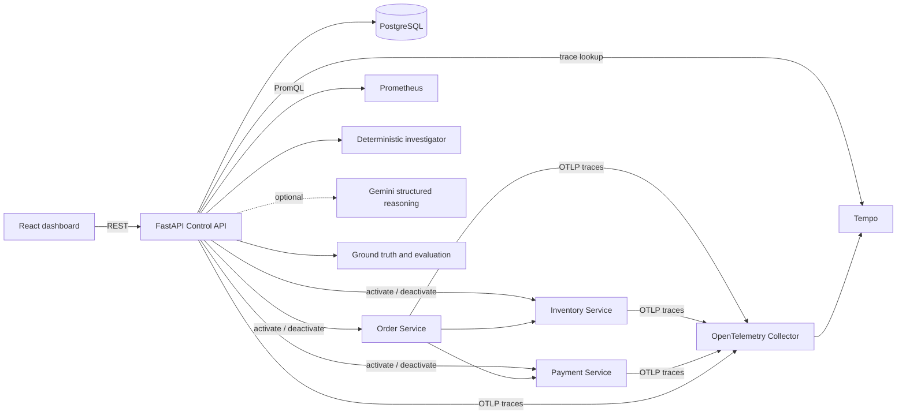
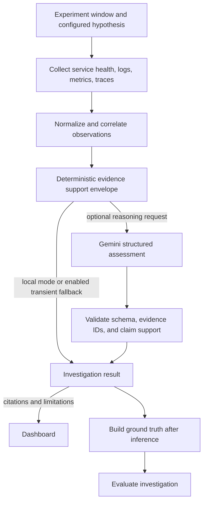

# FailureLab

FailureLab is a local distributed-systems lab for controlled incident simulation and evidence-grounded investigation. It activates bounded failures in a small service graph, observes the resulting behavior through logs, metrics, and traces, and builds an investigation whose claims link back to collected evidence.

## Why it exists

Production incidents often span several services and telemetry systems. Engineers have to distinguish a failing dependency from downstream symptoms, relate signals to the incident window, and communicate uncertainty. FailureLab makes that workflow repeatable: inject a known failure, collect the evidence, investigate it, and compare the result with controlled ground truth.

The deterministic investigator works offline. Gemini can contribute structured reasoning when configured, while FailureLab retains ownership of evidence records, citation validation, confidence, and evaluation.

## Architecture



### Services

| Service | Role |
| --- | --- |
| Control API | Experiment lifecycle, failure controls, evidence collection, investigation, evaluation, and verification endpoints. |
| Order Service | Calls inventory and payment, exposing distributed dependency effects. |
| Inventory Service | Reserves deterministic local stock and supports controlled failures. |
| Payment Service | Processes deterministic local payments and supports controlled failures. |
| PostgreSQL | Persists experiments, incidents, investigation snapshots, and verification results. |
| Prometheus and Tempo | Store and serve metrics and traces for investigations. |
| React dashboard | Creates experiments and presents service status, evidence, findings, limitations, and evaluation. |

## Demo flow

1. Start the stack and open the dashboard at <http://localhost:5173>.
2. Create an incident scenario and start its experiment.
3. The Control API activates the selected bounded failure on the target service and records the incident.
4. Send a request through the order flow (the experiment detail screen includes a request action) and inspect service health and telemetry.
5. Investigate the experiment. The result includes the root-cause outcome, cited evidence, timeline, affected services, confidence, limitations, and a recommended next action.
6. Stop the experiment or let its configured duration expire. The incident is marked resolved.
7. Evaluate the saved result against ground truth generated from the experiment context, then inspect the evaluation dimensions.

The dashboard also supports an insufficient-evidence scenario. It should abstain instead of inventing a cause when the evidence does not meet the support threshold.

### Screenshot/demo capture checklist

The repository does not currently include static UI screenshots. For a portfolio walkthrough, capture the Overview page with service health, an active Experiment detail page with the incident signals, and an Investigation result with its citations, confidence, limitations, and provider label visible. Use a local run with synthetic experiment data; do not include `.env` values or API keys in screenshots.

## Failure injection

The scenario catalog exposes a fixed set of supported failure/service combinations. The shared failure controller supports service unavailable (503), HTTP 500, latency, and timeout behavior. Latency and timeout leave health checks responsive; timeouts are distinct from HTTP failures. Experiments have a positive bounded duration (up to one hour), only one may run at a time, and the Control API deactivates the failure on stop or expiry.

Failure controls are for local development and demos only. Compose binds published ports to loopback, and service control endpoints are internal routes. Do not expose this stack or its failure controls to an untrusted network.

## Observability pipeline

Application services emit structured request logs, Prometheus metrics, and OpenTelemetry traces. Prometheus scrapes service metrics and the collector forwards traces to Tempo. Each process keeps a bounded in-memory request log buffer exposed only through an internal endpoint; the Control API collects these buffers during investigation. The buffers are local demo telemetry, not durable log storage. During investigation, FailureLab narrows evidence to the experiment window, target service, and correlated request/trace IDs. Missing telemetry remains a visible limitation and is not treated as healthy evidence.

## Investigation and evidence grounding



Gemini receives normalized evidence, not hidden ground truth. Its structured output is checked for schema validity, evidence membership, and claim support before it can influence the result. FailureLab constructs evidence records and confidence itself. Invalid structured output, unsupported citations, authentication errors, and configuration errors remain errors; they do not silently become local successes.

The local investigator is deterministic and uses an explicitly uncalibrated heuristic confidence score. Confidence is not a probability. When evidence is contradictory or insufficient, the investigator can abstain and return `root_cause: null`.

## Evaluation methodology

Ground truth is built after inference and is never sent to the investigator. The evaluator checks root-cause alignment with the injected failure and target service, affected-service correctness, evidence citation validity, and whether abstention was appropriate. The comparison benchmark runs both investigators on the same scenario context and reports provider metrics only for results from that provider.

The mock Gemini benchmark derives structured mock output from the local result. It checks the comparison pipeline only and is not evidence of Gemini quality or API latency. A local fallback after Gemini availability failure is separately labeled and excluded from Gemini metrics.

## Failure scenarios

The scenario catalog includes payment, inventory, and order-service cases for supported HTTP 500, unavailable, latency, and timeout behaviors, plus an insufficient-evidence case. Each scenario names its target, duration, expected behavior, and configured dependency impact. The API is the source of truth for the exact catalog.

## Run locally

Requirements: Docker Compose, Node.js/npm, and Python 3.12 for local tests. Copy `.env.example` to `.env` if you need overrides; `.env` is ignored by Git.

```bash
cp .env.example .env
docker compose up --build
```

The Control API applies Alembic migrations on startup. Once containers are healthy, start the Vite dashboard in another terminal:

```bash
cd frontend
npm ci
npm run dev
```

The dashboard proxies API calls to `localhost:8000` and order requests to `localhost:8001`. Useful local endpoints:

- Dashboard: <http://localhost:5173>
- Control API and OpenAPI: <http://localhost:8000/docs>
- Prometheus: <http://localhost:9090>
- Grafana: <http://localhost:3000>

Stop the containers with `docker compose down`. Persistent database and observability data remain in named volumes. `docker compose down -v` removes those volumes.

## Configuration

| Variable | Default | Purpose |
| --- | --- | --- |
| `POSTGRES_DB` / `POSTGRES_USER` / `POSTGRES_PASSWORD` | local development values | PostgreSQL connection. Replace defaults outside a private local demo. |
| `INVESTIGATOR_PROVIDER` | `local` | `local` or `gemini`. |
| `GEMINI_API_KEY` | empty | Optional server-side Gemini key. Never place it in frontend configuration. |
| `GEMINI_MODEL` | `gemini-3.8-flash` | Model used only when Gemini is selected. |
| `GEMINI_FALLBACK_TO_LOCAL` | `true` | Use the deterministic investigator after a transient Gemini service/availability failure. |
| `ORDER_SERVICE_URL` / `INVENTORY_SERVICE_URL` / `PAYMENT_SERVICE_URL` | Compose service URLs | Internal service addresses used by the Control API. |
| `CONTROL_API_PROXY` / `ORDER_API_PROXY` | local service URLs | Optional Vite development proxy overrides. |

For Gemini mode, set `INVESTIGATOR_PROVIDER=gemini` and provide `GEMINI_API_KEY` in `.env` or the process environment. A successful result is labeled `gemini`. With fallback enabled, a transient upstream failure returns a clearly degraded `local_fallback` result with the failure reason in limitations. The fallback is never presented as a Gemini result. Set `GEMINI_FALLBACK_TO_LOCAL=false` to preserve provider errors instead.

## Testing and benchmarks

From the repository root, with project dependencies installed:

```bash
make test
make lint
cd frontend && npm test && npm run build
cd ../services/control-api && python benchmarks/run.py --gemini mock
```

The backend tests include isolated service/API coverage and integration tests that exercise real local HTTP service processes. The mock benchmark is offline and repeatable. A real benchmark is an explicit external API call:

```bash
cd services/control-api
python benchmarks/run.py --gemini real
```

Real Gemini availability is external and can change independently of FailureLab. Recent configured-model calls returned upstream 503 high-demand errors. Therefore, a successful live Gemini quality comparison is currently **not verified**; no Gemini quality claim is made. When Gemini is unavailable, the comparison reports the failed attempt and local fallback separately and emits no Gemini quality score for that scenario.

## Limitations and future work

- This is a local demonstration environment, not a production-ready incident platform.
- Failure controls and sample service data are intentionally bounded and in-memory.
- Confidence is a deterministic heuristic, not a calibrated probability.
- External Gemini availability and live quality remain unverified until the upstream API responds successfully.
- Future work could add richer scenario coverage, calibrated evaluation, and deployment hardening after the core demo needs are established.
